<p align="center">
  
</p>

<p align="center">
  <a href="https://github.com/ST-DEVPT/rack-fan-control"></a>
  <a href="https://github.com/ST-DEVPT/smoketrace"></a>
  <a href="https://github.com/ST-DEVPT/Jellyflix"></a>
</p>

<br>

## 🌀 Fan Control

**Your rack server, whisper quiet, and never cooking.** A dashboard that takes the fans of Dell, Supermicro
and HPE servers off their datacenter profile, holds the temperature you choose with as little air as it can,
and hands the fans back to the BMC the second anything looks wrong.

<p align="center">
  <a href="https://github.com/ST-DEVPT/rack-fan-control"></a>
</p>

<table>
  <tr>
    <td width="33%" valign="top"><b>🧠 Smart mode</b><br><sub>Learns the speed each load needs on <i>your</i> server, sees heat coming and rides out bursts.</sub></td>
    <td width="33%" valign="top"><b>🛡️ Safety net first</b><br><sub>Failsafe, every BMC threshold, failed fans, a BMC that takes the fans back: the BMC decides when in doubt.</sub></td>
    <td width="33%" valign="top"><b>📏 Fan calibration</b><br><sub>One button measures every speed, the watts it costs and each fan's limit, then suggests the minimum.</sub></td>
  </tr>
  <tr>
    <td valign="top"><b>🎮 GPUs and disks too</b><br><sub>Extra curves on any sensor, and a host script for temperatures the BMC cannot see.</sub></td>
    <td valign="top"><b>🏠 Plays with the homelab</b><br><sub>Home Assistant, Proxmox, Prometheus, Grafana, Homarr, Discord, ntfy, Gotify.</sub></td>
    <td valign="top"><b>🪶 Nothing to babysit</b><br><sub>Plain Python, no dependencies, read-only container, English and Portuguese.</sub></td>
  </tr>
</table>

```bash
mkdir data && sudo chown 1000:1000 data
docker run -d -p 8080:8080 -v "$PWD/data:/data" -e WEB_PASSWORD=pick-one ghcr.io/st-devpt/rack-fan-control:2
```

<p>
  <a href="https://github.com/ST-DEVPT/rack-fan-control/releases"></a>
  <a href="https://github.com/ST-DEVPT/rack-fan-control/actions/workflows/docker.yml"></a>
  
  
</p>

<br>

## 📡 smoketrace

**SmokePing, with the route behind every spike.** Latency, jitter and loss for every target, and an mtr
traceroute taken in the same minutes, so a latency step and the route change that caused it sit on one screen,
and in your alerts.

<p align="center">
  <a href="https://github.com/ST-DEVPT/smoketrace"></a>
</p>

<table>
  <tr>
    <td width="33%" valign="top"><b>🧭 Reads mtr for you</b><br><sub>Which hops changed, which networks the path now crosses, where real loss starts, and which "loss" is only ICMP rate-limiting.</sub></td>
    <td width="33%" valign="top"><b>🌍 Seen from everywhere</b><br><sub>Agents at other sites, pushed or pulled; down for everyone or only from one place, at a glance.</sub></td>
    <td width="33%" valign="top"><b>🔔 Alerts that say why</b><br><sub>Discord, ntfy or a webhook, with the hop where loss starts and the AS path before and after.</sub></td>
  </tr>
  <tr>
    <td valign="top"><b>🔁 Off SmokePing in one go</b><br><sub>Reads its config as it is (targets, probes, slaves) and imports its RRD history.</sub></td>
    <td valign="top"><b>📈 Prometheus and Grafana</b><br><sub>Every target and site in /metrics, and a dashboard to import.</sub></td>
    <td valign="top"><b>🪶 Nothing to babysit</b><br><sub>One Python file, no dependencies, a container with only NET_RAW, English and Portuguese.</sub></td>
  </tr>
</table>

```bash
curl -O https://raw.githubusercontent.com/ST-DEVPT/smoketrace/main/docker-compose.yml && docker compose up -d
```

<p>
  <a href="https://github.com/ST-DEVPT/smoketrace/releases"></a>
  <a href="https://github.com/ST-DEVPT/smoketrace/actions/workflows/ci.yml"></a>
  
  
</p>

<br>

## 🍿 Jellyflix

**Your Jellyfin library on the living-room TV, the way Netflix feels.** An Android TV client written from
scratch in Kotlin and Compose for TV, made for a remote and a sofa.

<p align="center">
  <a href="https://github.com/ST-DEVPT/Jellyflix"></a>
</p>

<table>
  <tr>
    <td width="33%" valign="top"><b>🎬 Full-screen highlights</b><br><sub>Film logos over the backdrop, and a Continue watching row front and centre.</sub></td>
    <td width="33%" valign="top"><b>🔟 Rows that come alive</b><br><sub>Cards grow with the focus; a numbered Top 10 like you know it.</sub></td>
    <td width="33%" valign="top"><b>🔊 Your best formats</b><br><sub>4K, HDR, HEVC 10-bit, Dolby Atmos and TrueHD, shown and played.</sub></td>
  </tr>
</table>

<p>
  <a href="https://github.com/ST-DEVPT/Jellyflix/releases/latest"></a>
  
  
  
</p>

<br>

## How we build

|  |  |
| --- | --- |
| **When unsure, hand it back** | Software that controls hardware must fail towards the safe side, every time. |
| **No dependency we can avoid** | Fewer moving parts, smaller images, nothing to keep patching. |
| **Every fix comes with its test** | Unit and browser tests on every push; a bug fixed once stays fixed. |
| **Honest docs** | What works, what is experimental, and what no software can cover. |

<p align="center"><sub>Made in Portugal 🇵🇹 · Found a bug or hardware we have not seen? Open an issue on the project.</sub></p>
